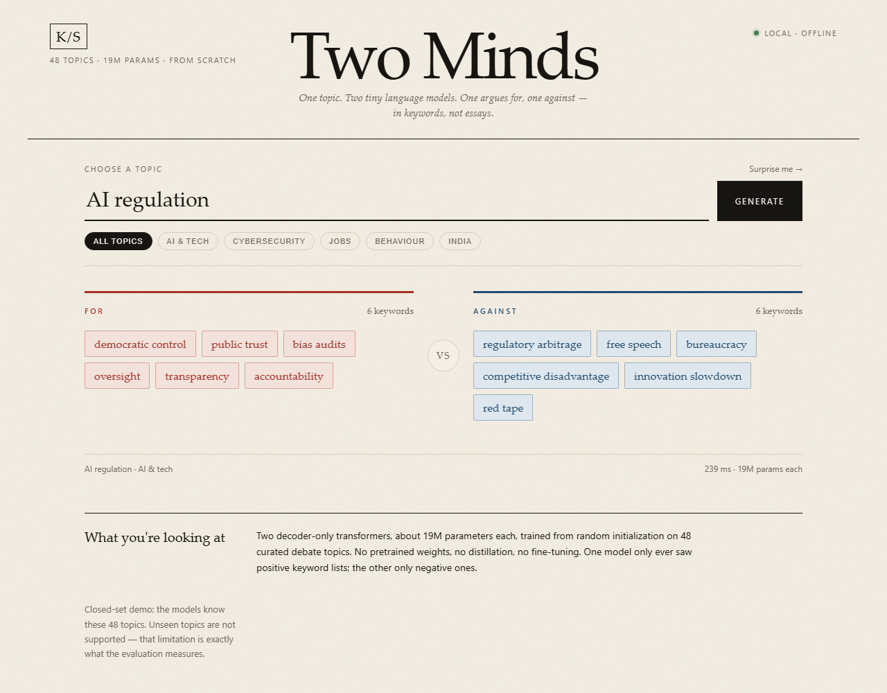

# keyword-stance

Two small language models trained **from scratch** — no pretrained weights, no distillation, no fine-tuning. One emits positive keywords for a topic; the other emits negative keywords. A local web app puts them side by side.

This repository implements **Two Minds (TwinMinds)**, two small language models trained from scratch to generate polarized stance keywords, adapted to a **48-topic closed set** with an open-domain retrieval fallback.



## Status

| Piece | State |
|---|---|
| From-scratch transformer (RoPE, RMSNorm, GQA, SwiGLU, weight tying) | done |
| Training loop (bf16, cosine schedule, eval, checkpoints) | done |
| Word-level tokenizer (stdlib only) | done |
| Curated 48-topic keyword sheet | done |
| Positive + negative models | trained (19M params each, ~90 s each) |
| Held-out generalization test | done — negative result on raw LM (see below) |
| T0 Open-domain retrieval fallback | done (TF-IDF char+word index, confidence, low-confidence warning) |
| Local web app (FastAPI + HTML/CSS/JS) | done (supports exact match + open domain) |
| Open-domain evaluation benchmark | done (100% paraphrase top-3, 100% OOD alert rate) |

## Run the app

```powershell
cd keyword-stance
..\.venv\Scripts\python.exe -m uvicorn app:app --host 127.0.0.1 --port 8000
```

Open <http://127.0.0.1:8000>. The models load and warm up in ~15 s; requests then take ~250 ms.

## What the models are

| | Positive model | Negative model |
|---|---|---|
| Parameters | 19,009,536 | 19,025,280 |
| Layers / heads / width | 8 / 6 / 384 | same |
| Vocabulary | word-level, built from training text | same |
| Training data | 1,440 records over 48 topics | same |
| Steps | 2,500 | 2,500 |
| Training time | ~90 s | ~90 s |
| Hardware | RTX 5070 Ti Laptop, bf16 | same |

Both start from random initialization. The only difference is the data: one model never saw a negative keyword list, the other never saw a positive one. Stance is baked into the weights.

## Data

`data/curated/topics.jsonl` — 48 topics across AI/tech, cybersecurity, jobs, behaviour, and India, each with 8 positive and 8 negative keywords.

For this deadline the dataset is **curated**, not extracted: I drafted the keyword sets from domain knowledge, and they still need a human pass. It is not distillation — no teacher model's logits or generations are used — but it is hand-authored supervision, and the report should say so.

Build commands:

```powershell
# 40 train topics + 8 held-out topics (for the generalization test)
..\.venv\Scripts\python.exe -m src.data.build_dataset

# all 48 topics (the models used by the app)
..\.venv\Scripts\python.exe -m src.data.build_all
```

## Train from scratch

```powershell
# positive model
..\.venv\Scripts\python.exe -m src.train --data data/pro/all.jsonl --out outputs/pro-big `
  --n-layer 8 --n-head 6 --n-embd 384 --block-size 96 --batch-size 32 `
  --max-steps 2500 --lr 5e-4 --dropout 0.05

# negative model
..\.venv\Scripts\python.exe -m src.train --data data/con/all.jsonl --out outputs/con-big `
  --n-layer 8 --n-head 6 --n-embd 384 --block-size 96 --batch-size 32 `
  --max-steps 2500 --lr 5e-4 --dropout 0.05
```

Sample from the CLI:

```powershell
..\.venv\Scripts\python.exe -m src.generate --ckpt outputs/pro-big/ckpt.pt --topic "AI regulation"
```

## Generalization (the honest result)

The 40-topic, 6.4M-parameter models were tested on 8 topics they never saw. They fail in a specific, useful way: unseen topics collapse onto the nearest trained topic. (The final app uses 19M models trained on all 48 topics; the holdout experiment was run before that, and time did not allow repeating it at 19M.)

| Prompt | Expected (con) | Model output |
|---|---|---|
| remote work | isolation, real estate, collaboration | cyber fraud, outage risk, dispute resolution |
| farm laws | MSP threat, corporate control | complexity, refund delays, federal friction |

At 6.4M parameters there is no world knowledge to fall back on, only the 40 topics in the corpus. That is why the app is a closed set. This negative result is worth a paragraph in the report — it is the difference between "small model" and "small model with a lookup table."

Seen topics work well:

| Topic | FOR | AGAINST |
|---|---|---|
| AI regulation | oversight, public trust, accountability | regulatory capture, free speech, compliance costs |
| UPI | financial inclusion, instant payments, low cost | cyber fraud, privacy, digital divide |
| four-day workweek | productivity, wellbeing, lower turnover | labor costs, service coverage, sector fit |

## Measured training throughput (benchmark config)

RTX 5070 Ti Laptop (12 GB), torch 2.11.0+cu128, bf16, 25.2M-parameter model, batch 64 × 256:

| Metric | Value |
|---|---|
| Throughput | 92,753 tok/s (≈ 334M tokens/hour) |
| Peak VRAM | 7.0 GB |
| Step time | 177 ms |

Two 150M-token runs fit in ~1 hour. The 6.4M demo models train in ~30 s each; the bottleneck is data, not compute.

## Layout

```
keyword-stance/
├── app.py                   # FastAPI server + generative & retrieval routing
├── web/                     # index.html, styles.css, app.js (with retrieval banners)
├── src/
│   ├── retrieval.py         # T0 TF-IDF char+word n-gram index with topic aliases
│   ├── data/
│   │   ├── text.py          # tokenizer, vocab, record formatting
│   │   ├── build_dataset.py # 40 train / 8 held-out split
│   │   ├── build_all.py     # all 48 topics
│   │   └── make_dummy.py    # pipeline smoke test
│   ├── model/gpt.py         # decoder-only transformer
│   ├── train.py             # training loop
│   └── generate.py          # CLI sampling
├── data/curated/topics.jsonl
├── outputs/                 # checkpoints (gitignored)
└── scripts/
    ├── bench.py             # throughput benchmark
    ├── test_retrieval.py    # smoke test for retrieval fallback
    └── eval_open_domain.py  # comprehensive open-domain benchmark
```

## T0 Open-Domain Retrieval Fallback

The app supports open-domain queries through a dual-mode engine:
1. **Generative mode (Exact match):** When the query matches one of the 48 trained topics, the two 19M-parameter transformers generate stance keywords directly.
2. **Retrieval mode (Paraphrases & OOD):** For any other input, a blended TF-IDF index (character n-grams 2–4 + word unigrams/bigrams + topic aliases) maps the query to the nearest known topics and merges their keywords.
3. **Honest uncertainty:** If similarity confidence is < 0.15, the UI displays a quiet warning alerting the user that the topic is outside the model's knowledge boundary.

### Benchmark Results (`scripts/eval_open_domain.py`)

| Test Suite | Metric | Result |
|---|---|---|
| Exact Match (10 queries) | Routing Accuracy | **100.0%** (<0.01 ms) |
| Paraphrases / Synonyms (12 queries) | Top-1 Accuracy | **100.0%** (mean sim: 0.33) |
| Paraphrases / Synonyms | Top-3 Accuracy | **100.0%** |
| Out-of-Domain (10 queries) | Correct Uncertainty Alert Rate | **100.0%** (score < 0.15) |
| Retrieval Latency | Average | **~3.9 ms** |

## Design notes

- **Word-level vocab.** Outputs are keyword lists, so a word-level tokenizer removes a dependency and keeps sequences short.
- **One model per stance.** Stance lives in the weights, not the prompt.
- **Packed token stream.** Records are concatenated with `<eos>`; batches are random windows.
- **No trainer library.** The loop is ~200 lines, every knob visible.
- **Dual-mode open-domain.** Generative for closed-set + retrieval fallback for open-ended queries, with transparent uncertainty labeling.

## Limitations

- Hand-curated data, not a statistical extraction pipeline. Needs review.
- 6.4M parameters cannot generalize to unseen topics without retrieval; the held-out test shows it.
- The generative model sometimes repeats a keyword or stops at 5–7 keywords; the API dedupes and caps at 8.
- No KV cache in `generate`; irrelevant at this size, but slow if scaled.
- No prompt-loss masking; the prompt is a small fraction of each sequence.
